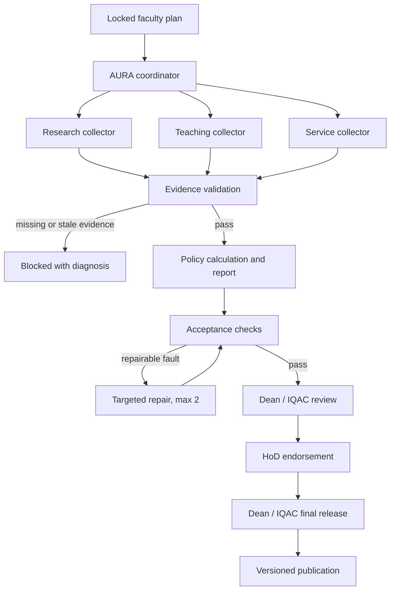

# Architecture and engineering notes

## Runtime flow

Each human stage is a real LangGraph `interrupt`, backed by `SqliteSaver`. A successful API authentication, role check and recorded decision are required to resume it. No browser role selector and no agent-generated approval can bypass these gates. The release node checks the evidence, source hashes, consent fingerprint, policy version, acceptance checks and all three approvals again inside a transaction.

## Components and responsibilities

| Module | Responsibility |
|---|---|
| `importer.py` | Offline extraction and original-source provenance; not a live integration |
| `connector.py` | Single governed source surface: scoped candidates, consented collection, integrity checks, policies and history |
| `contracts.py` | Pydantic plan, policy, activity, evidence and decision inputs |
| `skills.py` | Reusable planning and report-format skills |
| `workflow.py` | Coordinator, typed graph state, parallel specialist nodes, validation, bounded repair and human gates |
| `batch.py` | Multiple faculty plans in parallel, plan-alignment selection and merge audit |
| `specialists.py` | Balanced, teaching, research and administrative emphasis with grounded activity highlights |
| `scoring.py` | Decimal-based calculation with method, divisor, weight, cap, evidence and clause references |
| `memory.py` | Scoped archive retrieval; local lexical embeddings or optional Ollama semantic embeddings; optional narrative drafting |
| `store.py` | SQLite repository, reentrant transactions and hash-linked audit events |
| `security.py` | Password hashing, session checks, role/scope enforcement and persistent login throttling |
| `reports.py` | PDF exports from immutable, released report snapshots |
| `main.py` | Authenticated REST connector surface, lifecycle endpoints and static frontend |
| `mcp_server.py` / `mcp_client.py` | Optional MCP stdio/SSE server and protocol smoke-test client |

The browser application uses the authenticated REST API. A separate MCP server exposes connector operations over stdio or SSE; its SSE bind accepts only numeric loopback addresses. It is restricted to an initialized, marked synthetic database under `runtime-demo/` and rejects other database paths. Its current tool arguments allow a caller to provide role/scope fields, and the MCP process does not authenticate that caller. Treat it as a local synthetic-data development/demo integration only; do not connect it to real appraisal data or expose it to untrusted clients until caller authentication and authorization are implemented. A future live-source adapter belongs behind `Connector`, not inside an agent.

## State, knowledge and history

- `runtime/app.db`: user accounts, consents, source metadata, staged activities, evidence decisions, immutable approved policy versions, plans, run projections, releases, appeals and audit events.
- `runtime/checkpoints.db`: LangGraph thread state. A run ID is its thread ID. Recreating the runtime does not discard a paused review or completed graph steps.
- `runtime/uploads/`: private added documents, referenced by generated IDs and verified SHA-256 checksums.
- `data/source/`: unchanged supplied originals; never mounted as public web assets.
- Released reports are immutable snapshots. `active` stores the selected release per faculty profile. Rollback updates only that pointer and adds an audit event.

Source data and approved history are separate from a graph's mutable run state. Retrieval filters by faculty scope and optional category, and checks current source consent for activity retrieval. Historical releases remain records of previous approved decisions; revoking consent stops future source processing, not retention of an already approved audit record.

## Recovery and budgets

A locked plan records a maximum of 30 audited agent-node executions, 120 seconds per synchronous graph invocation and two repair attempts. The graph recursion limit is also bounded. The 120-second limit is checked between node operations; this is not a sandbox that can pre-empt arbitrary custom adapter code. The provided local Ollama call has its own 30-second timeout and optional embeddings have a 20-second timeout.

A failed/interrupted run can be resumed from its durable checkpoint, provided its source fingerprint is unchanged. If inputs changed, build a revised plan. Non-fabricable failures (missing evidence, absent consent, changed source or unmatched rules) escalate immediately. Repairable report problems restore citations from verified records or recompute arithmetic using the locked policy; they never create supporting documents.

Node audit records capture input references, hashes and outputs. The repository retains source rows and files for resolution of those references. Audit events include named approvals, exclusions, overrides, appeals and rollback. The hash chain detects accidental or partial tampering; it is not protection against a database owner who rewrites the entire chain. Independent signed/offline backups are needed for stronger operational audit guarantees.

## Privacy and access

The implementation is scoped to one departmental pilot. Faculty access is bound to a verified faculty ID and enforced on the server. HoD, Dean and IQAC are authorities for that configured department; cross-department deployments require adding departmental scope checks before use.

Whole departmental sources are not available to faculty accounts. Faculty can view their extracted activity records and download files they uploaded. Raw student feedback is never collected; supplied teaching data is aggregate only. Technical administrators can manage identities and accounts but cannot inspect unreleased calculated reports. Raw audit traces are limited to Dean/IQAC because they can contain pre-release calculations.

Passwords use PBKDF2-HMAC-SHA256 with random salts and 600,000 iterations. Sessions use random tokens, stored as hashes; cookies are HttpOnly and SameSite=Strict. Mutating authenticated calls require a CSRF token. The server sends a restrictive content security policy, same-origin fetch restrictions and no external analytics or CDN resources. Uploaded documents are downloaded as attachments, not served as executable assets.

## Models and limits

Optional Ollama drafting receives only scoped, structured report facts over localhost. Source material is treated as untrusted data. Returned citations must be a subset of provided evidence IDs and novel numeric claims are rejected. These checks are not semantic proof of every sentence: human review remains mandatory. Unavailable or rejected model output falls back to deterministic text, visibly labelled in the report view. AI never calculates the authoritative score or approves publication.

Specialist tracks change the ordering/emphasis of grounded evidence and require a matching approved track-specific policy. They do not invent different scoring multipliers. The institutional rubric must fit the supported arithmetic methods; more complex authorship/funding rules need an explicit reviewed extension and corresponding tests.

## Reference documentation

Consulted for the implementation:

- [LangGraph persistence](https://docs.langchain.com/oss/python/langgraph/persistence)
- [LangGraph interrupts and resume](https://docs.langchain.com/oss/python/langgraph/interrupts)
- [Ollama local generation API](https://docs.ollama.com/api/generate)
- [Ollama embeddings API](https://docs.ollama.com/api/embed)

Python packages are pinned in `requirements.txt`. The tested Python version is 3.12. This package is for VS Code/local execution and is not deployed to public hosting.
